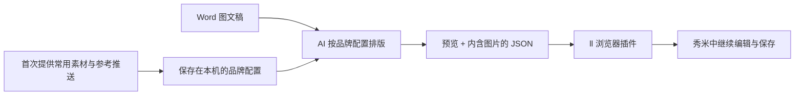
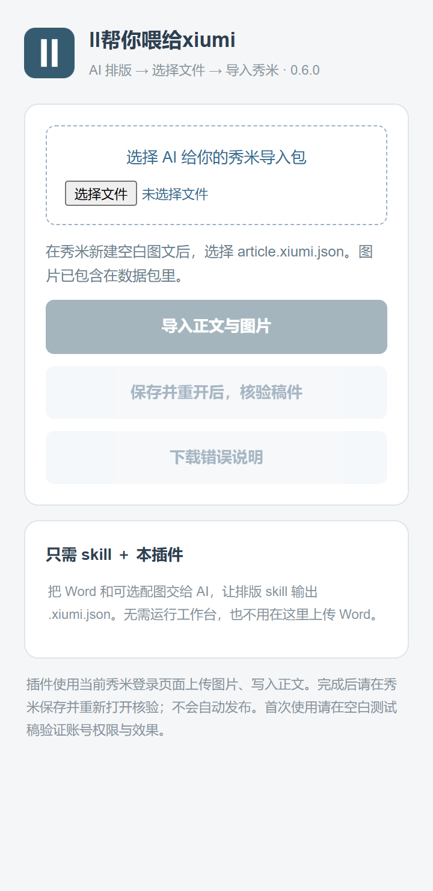

<p align="center">
  
</p>

<h1 align="center">ll帮你喂给xiumi</h1>

<p align="center">给 AI 一篇 Word，让它按你的品牌排版，再把图文一起导入秀米。</p>

<p align="center">
  <a href="https://github.com/zongmoseu/ll-xiumi/releases/latest">下载完整工作流</a> ·
  <a href="docs/getting-started.md">安装与使用</a> ·
  <a href="https://github.com/zongmoseu/ll-xiumi/issues">反馈问题</a>
</p>

## 从稿件到秀米

**一份通用排版 skill + 一个浏览器插件。** 在 AI 对话中完成排版和修改，在秀米里继续编辑、审核与发布。



首次使用，AI 会询问你的账号名称、常用封面、Logo、开头、尾图及可选参考推送，建立可复用的品牌配置。以后提供新稿即可；管理多个账号时，每个账号分别保存。暂时没有素材，也可以明确选择基础样式先排。

## 一套固定、可复用的排版

默认采用浅蓝页底、白色细框、蓝底标签标题、22px框内留白和14px正文。同组照片左右排列、间距8px，每张独立；保留导语、结语、引语、表格和透明底署名等组件，不附带机构尾图。更换AI工具时也应调用随包脚本执行这套规范。

首次素材建档用于替换自己的Logo、头尾图和封面，不会自动换掉整套排版。只有明确提出视觉修改时才覆盖默认。

## 能做什么

- **沿用自己的品牌。** 复用配色、留白、标题样式和已确认的头尾组件，封面与正文开头分开管理。
- **直接读取图文稿。** 支持 `.docx`、Markdown、文本和可选图片包，保留原文、图片、强调与表格。
- **在对话里打磨。** 例如“文字离框远一点”“图片缩小一点”“这两张左右排，中间留 8px”。
- **图片随稿交付。** `article.xiumi.json` 内含图片，插件在当前秀米登录页面上传图片并写入正文。
- **多图保持独立。** 上下排或左右留缝排列均可，每张保留独立图片资源，不把文章做成一张不可编辑的长图。

## 三步开始

### 1. 安装 skill 和插件

下载 [最新版本](https://github.com/zongmoseu/ll-xiumi/releases/latest) 中的完整工作流压缩包，解压后：

| 部件 | 放在哪里 | 做什么 |
| --- | --- | --- |
| `skills/wechat-brand-layout` | AI 助手的技能目录 | 读取稿件、理解素材、排版、生成预览与 JSON |
| `plugins/ll-xiumi-importer` | Chrome / Edge「加载已解压的扩展」 | 把 JSON 中的图片与正文导入秀米 |

也可分别下载 skill 或插件安装包。具体步骤见 [安装指南](docs/getting-started.md)。需要支持本地技能与脚本执行的 AI 助手；只把 skill 文件发给无法访问文件的聊天工具，不能完成转换。

### 2. 把稿件交给 AI

```text
用 wechat-brand-layout 帮我的公众号排版这篇 Word。
第一次使用，请先收集我的常用素材，建立品牌配置。
保留原文和配图，交付秀米导入 JSON 和预览。
```

素材可以是文件夹、ZIP 或单独图片；不需要每一类都齐全。看完预览，直接用自然语言提出修改。

### 3. 交给秀米

在秀米登录并新建空白图文，打开 **ll帮你喂给xiumi**，选择 AI 给你的 `article.xiumi.json`，点击 **导入正文与图片**。完成后核对标题、摘要和配图，在秀米手动保存，重新打开核验。

<details>
<summary>查看插件界面</summary>

<p></p>

</details>

## 使用前了解

- 主流程使用插件导入 JSON；不依赖秀米的 HTML 导入入口。当前账号权限和秀米版本仍会影响图片上传与导入。
- AI 负责理解稿件与选择布局。提取脚本本身不会自动完成语义排版，用户反馈也通过 AI 对话处理。
- 插件使用你当前的秀米登录状态，不自动登录或发布。封面、标题摘要等后台信息需按交付说明核对。
- 品牌配置默认存放在 `~/.codex/data/wechat-brand-layout/profiles/`，设置 `CODEX_HOME` 时跟随该目录。用户素材和稿件不进入本仓库；迁移电脑时另行备份配置目录。
- 已验证本地排版、图片打包、插件读取及模拟导入流程；同一导入核心已有用户真实导入成功反馈。不同账号、保存后重开和后续秀米版本仍需实测，不承诺所有布局完全一致。

## 项目结构

```text
skills/wechat-brand-layout/    通用排版 skill、素材建档与转换脚本
plugins/ll-xiumi-importer/     Chrome / Edge 浏览器插件
docs/                         安装指南与界面截图
tests/                        不含个人素材的合成测试
scripts/package_workflow.py   生成完整工作流、skill、插件三个安装包
```

AI 侧需要 Python 3.10+ 和 skill 内 `requirements.txt` 所列依赖；插件无需 Node.js 服务或另配 API Key。开发与打包方法见 [维护说明](docs/development.md)。

## 来源

本项目从 [ll 技能库](https://github.com/zongmoseu/ll) 的通用排版工作流独立整理。秀米导入与核验核心基于 [Infunus/OpsLion](https://github.com/Infunus/OpsLion) 的 Xiumi Bridge；保留其 CC0 许可，见 [来源说明](plugins/ll-xiumi-importer/NOTICE.md) 和 [上游许可证](plugins/ll-xiumi-importer/UPSTREAM-LICENSE)。本项目与秀米官方无隶属关系。
